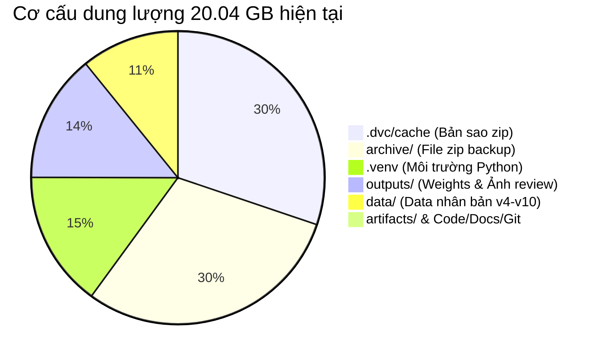
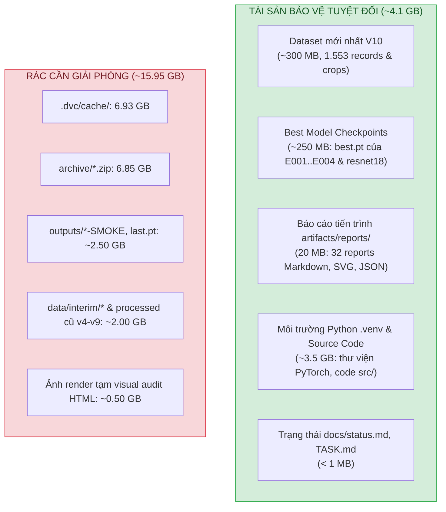
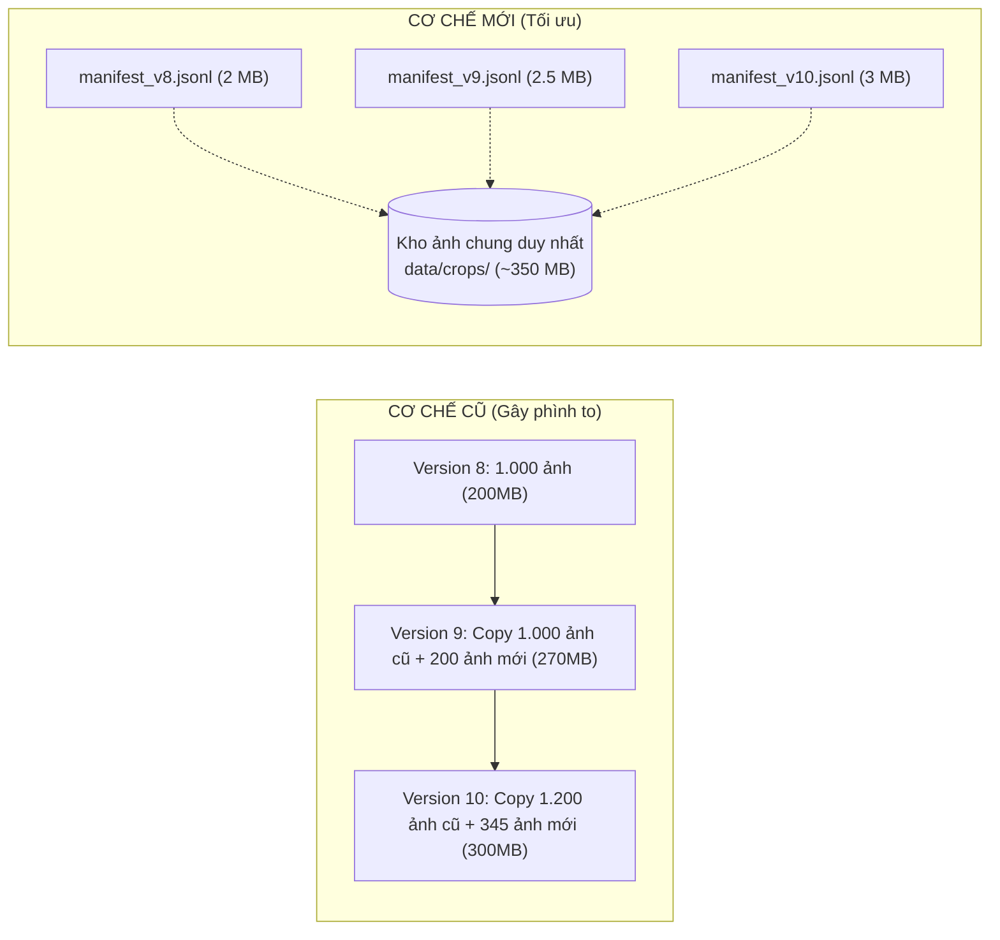

# BÁO CÁO NGHIÊN CỨU TOÀN DIỆN: PHÂN TÍCH DUNG LƯỢNG VÀ CHIẾN LƯỢC TỐI ƯU HÓA STORAGE

> **Ngày thực hiện:** 16/10/2026  
> **Dự án:** AI Exam Monitoring (`ai-exam-monitoring-final`)  
> **Hiện trạng:** 20.04 GB | 2 hành vi (`phone_use`, `looking_around`) | 1.061 ảnh train  
> **Mục tiêu tương lai:** 5–6 hành vi | Dung lượng kiểm soát dưới 8–10 GB  

---

## 1. BẢNG TỔNG HỢP DUNG LƯỢNG THỰC TẾ TRONG CODEBASE

Dưới đây là số liệu đo đạc chính xác trên toàn bộ cây thư mục của repository:

| Thư mục | Dung lượng | Tỷ lệ % | Số lượng file | Bản chất nội dung |
|---|---:|---:|---:|---|
| **`.dvc/cache`** | **6.93 GB** | **34.6%** | 617 | **Bản sao trùng lặp (Content-addressable store)**: DVC tự động copy lại từng file zip từ thư mục `archive/` vào cache nội bộ. |
| **`archive/`** | **6.85 GB** | **34.2%** | 17 | **Các file ZIP backup local**: Chứa 6 gói zip nén toàn bộ codebase, data và output qua từng đợt task (`history`: 2.47GB, `rc1`: 2.07GB, `c345`: 1.00GB, `v9`: 1.00GB,...). |
| **`.venv/`** | **3.45 GB** | **17.2%** | 33.554 | **Môi trường ảo Python**: Chứa PyTorch CPU, Torchvision, Mypy, Ruff, Numpy... Bắt buộc phải có để chạy mã nguồn. |
| **`outputs/`** | **3.25 GB** | **16.2%** | 2.669 | **Checkpoints & Rendered Visual Audits**: 43 thư mục kết quả. Chứa hàng loạt weights của các lần chạy thử (smoke runs), file `last.pt` (lưu optimizer state) và hàng ngàn ảnh JPG/PNG render phục vụ HTML audit. |
| **`data/`** | **2.49 GB** | **12.4%** | 12.532 | **Nhân bản ảnh qua nhiều tầng version**: <br>• `data/interim` (830 MB): 12 thư mục nháp crop/review cũ.<br>• `data/processed` (1.64 GB): Mỗi release (`v4` → `v10`) lại copy một bộ thư mục `crops/` riêng. |
| **`artifacts/`** | **0.02 GB (20 MB)** | **0.1%** | 468 | **Báo cáo nghiên cứu & Chỉ số**: Toàn bộ 32 báo cáo Markdown, đồ thị SVG, file json metrics từ E001 đến E004. **Rất nhẹ và cực kỳ giá trị**. |
| **Code, Docs, Git** | **~0.02 GB (25 MB)** | **0.1%** | ~3.700 | Mã nguồn `src/`, tài liệu `docs/`, tests, configs và lịch sử commit `.git`. |
| **TỔNG CỘNG** | **~20.04 GB** | **100%** | **~52.800** | |



---

## 2. NGUYÊN NHÂN CỐT LÕI (ROOT CAUSE ANALYSIS)

### 2.1. Tại sao mới 2 hành vi và ~1.000 ảnh mà đã tốn tới 20 GB?

Nguyên nhân không nằm ở kích thước mô hình hay số lượng ảnh thực tế, mà nằm ở **quy trình MLOps bảo toàn cực đoan (Byte-exact immutable preservation)** được quy định trong `AGENTS.md` và `docs/`:

1. **Vòng lặp nhân bản ZIP + DVC Cache (Chiếm 13.78 GB - gần 70% project):**
   - Theo quy tắc cũ, mỗi khi hoàn thành 1 task (kể cả chỉ thêm 300 crop ảnh), hệ thống lại nén toàn bộ không gian làm việc thành một file zip 1–2 GB lưu vào `archive/*.zip`.
   - Ngay sau đó, lệnh `dvc add` được thực thi, khiến DVC lại copy thêm một bản sao y hệt của file zip đó vào thư mục ẩn `.dvc/cache/`.
   - **Hậu quả:** 1 lần backup thực chất bị nhân đôi thành **2 lần dung lượng** ngay trên cùng một ổ cứng D:.

2. **Cơ chế lưu trữ Checkpoint Training lãng phí (Chiếm ~2.5 GB trong `outputs/`):**
   - File `last.pt` (~150 MB/file) chứa đầy đủ trạng thái của AdamW Optimizer (first moment, second moment của toàn bộ trọng số mạng ResNet18) để phục vụ tính năng Resume. Trong khi file mô hình inference thực sự (`best.pt`) chỉ nặng **42.7 MB**.
   - Các lần chạy thử kiểm tra đường ống (Smoke runs: `E004-C345-W-H-SMOKE`, `E004-RC1-*-SMOKE`, `E004-V9-*-smoke`) chỉ chạy 1–2 batch nhưng vẫn lưu đủ cả `last.pt` (150MB) và `best.pt` (43MB).
   - Có tới 8 folder smoke runs và 1 folder orphan snapshot đang lưu trữ hơn **1.5 GB weights rác**.

3. **Cơ chế Render ảnh cho HTML Visual Audit (Chiếm ~500 MB trong `outputs/`):**
   - Khi thực hiện kiểm toán dữ liệu (như `E004-crop-bundle-review-20261014`), hệ thống xuất ra hàng ngàn file ảnh tĩnh `.jpg`, `.png` để nhúng vào trang HTML xem trước (riêng thư mục review ngày 14/10 chứa tới **1.074 ảnh tĩnh = 306 MB**). Khi đợt review kết thúc, các file ảnh này không bao giờ được dọn dẹp.

4. **Nhân bản Dataset qua từng version (Chiếm ~2.0 GB trong `data/`):**
   - Thay vì lưu ảnh ở một nơi và dùng file danh sách (manifest) để quản lý phiên bản, mỗi lần ra version mới (`v4`, `v5`, `v6`, `v7`, `v8`, `v9`, `v10`), hệ thống lại tạo một folder mới và copy toàn bộ các file ảnh crop vào đó.
   - Thư mục `e004/E004-c345-development-20261016` (298 MB) là bản copy y hệt của `pilot-b/pilot-b-20261016-v10` (298 MB).
   - Thư mục `data/interim` lưu trữ 12 folder nháp trung gian (830 MB) từ các đợt crop thử nghiệm.

### 2.2. Đánh giá dự báo: *"Nếu để thế này có lên tới hàng TB khi làm 5–6 hành vi không?"*

> [!WARNING]
> **Khẳng định: Chắc chắn sẽ chạm ngưỡng hàng trăm GB đến 1 TB.**
> 
> Hiện tại, với **2 hành vi** và **1.061 ảnh train**, dự án đã tiêu tốn **20 GB**.
> Khi mở rộng lên **5–6 hành vi** (ví dụ: quay cóp, trao đổi tài liệu, nhìn bài bạn, rời vị trí, thiết bị lạ/tai nghe...):
> - Số lượng ảnh crop tối thiểu sẽ cần từ **10.000 đến 30.000 ảnh** (khoảng 2–5 GB ảnh gốc).
> - Số đợt thử nghiệm (experiments, tuning, ablation runs) sẽ cần thêm ít nhất 20–30 vòng lặp.
> - **Nếu giữ quy trình cũ:** Mỗi vòng lặp sinh ra 1 file zip (2–5 GB) + 1 DVC cache blob (2–5 GB) + weights smoke (1 GB) + ảnh review HTML (0.5 GB) $\rightarrow$ Mỗi vòng lặp tốn thêm **5–12 GB**.
> - Sau 30–50 vòng lặp, dung lượng tích lũy sẽ vượt **300 GB – 600 GB**, và cùng với các bản snapshot lịch sử, dự án sẽ nhanh chóng chạm mức **1 TB**!

---

## 3. PHÂN ĐỊNH TÀI SẢN: CÁI CẦN GIỮ VS CÁI CẦN XÓA

Theo đúng định hướng của bạn:
- **Chỉ giữ:** Bản dataset mới nhất + Các model đã trải qua + Báo cáo từng quá trình + Trạng thái hiện tại.
- **Loại bỏ hoàn toàn:** Toàn bộ truy vết byte-exact, backup zip trùng lặp, cache DVC, weights rác và ảnh render tạm.



### Chi tiết các Model Checkpoints cần bảo vệ (`best.pt`):
Tất cả các model tốt nhất đã trải qua đều được giữ nguyên vẹn tại thư mục gốc của chúng:
1. `outputs/pretrained/resnet18-f37072fd.pth` (44.66 MB - Backbone khởi tạo)
2. `outputs/E001/best.pt` (0.01 MB - Linear probe baseline 1)
3. `outputs/E002/best.pt` (0.01 MB - Linear probe baseline 2)
4. `outputs/E003/best.pt` (0.01 MB - Linear probe baseline 3)
5. `outputs/E004-V9-LP/best.pt` (42.73 MB - Linear probe trên V9)
6. `outputs/E004-V9-L4/best.pt` (42.73 MB - Fine-tune Layer 4 trên V9)
7. `outputs/E004-RC1-R-H/best.pt` (42.73 MB - RC1 fine-tune)
8. `outputs/E004-RC1-R-L/best.pt` (42.73 MB - RC1 fine-tune)
9. `outputs/E004-RC1-W-H/best.pt` (42.73 MB - RC1 fine-tune)
10. `outputs/E004-RC1-W-L/best.pt` (42.73 MB - RC1 fine-tune)
11. `outputs/E004-C345-W-H/best.pt` (42.74 MB - Model mới nhất sau khi nạp 345 crop)

> [!NOTE]
> Tổng dung lượng của toàn bộ 11 models trên chỉ vỏn vẹn **~250 MB**!

---

## 4. KẾ HOẠCH DỌN DẸP CHI TIẾT (GIẢI PHÓNG NGAY ~16 GB)

### Bước 1: Dọn dẹp DVC Cache và Archive Zip (~13.78 GB)
- Xóa toàn bộ nội dung trong thư mục `.dvc/cache/`.
- Xóa các file `.zip` lớn trong `archive/` (`history-20261010.zip`, `e004-rc1-execution-20261014.zip`, `e004-c345-execution-20261016.zip`, v.v.).
- **Giữ lại:** File `archive/index.json` và các file metadata `.zip.dvc` (đây là các file text chỉ vài KB, giữ lại để script `scripts/check_repo.py` không báo lỗi đường dẫn metadata).

### Bước 2: Dọn dẹp Outputs rác (~2.50 GB)
- **Xóa toàn bộ các thư mục chạy thử (Smoke runs) & Snapshot mồ côi:**
  - `outputs/E001-smoke/`, `outputs/E002-smoke/`, `outputs/E003-smoke/`
  - `outputs/E004-C345-W-H-SMOKE/`, `outputs/E004-C345-W-H-orphan-snapshot/`
  - `outputs/E004-RC1-*-SMOKE*` (4 thư mục RC1 smoke)
  - `outputs/E004-V9-*-smoke` (2 thư mục V9 smoke)
  - `outputs/_scratch/`
- **Xóa các file `last.pt` trong các run chính thức:**
  - Trong `outputs/E004-C345-W-H/`, `outputs/E004-RC1-*/`, `outputs/E004-V9-*/`: Xóa file `last.pt` (150 MB/file).
  - Giữ lại: `best.pt`, `run.json`, `metrics.json`, `history.json`, `resolved-config.json`, `predictions-*.json`.
- **Xóa các thư mục ảnh render HTML visual review:**
  - `outputs/E004-crop-bundle-review-20261014/` (306 MB ảnh tĩnh)
  - `outputs/E004-crop-bundle-refinement-20261015/` (70 MB)
  - `outputs/E004-crop-bundle-audit-20261014/` (55 MB)
  - `outputs/E004-device-consistency-20261015/` (43 MB)
  - `outputs/E004-new-bundle-audit-20261015/` (39 MB)
  - `outputs/E004-visual-audit-20261014/` (13 MB)

### Bước 3: Dọn dẹp Dataset nháp và Version cũ (~2.00 GB)
- Xóa sạch toàn bộ thư mục `data/interim/*` (830 MB ảnh cắt nháp).
- Trong `data/processed/pilot-b/`: Xóa các thư mục crops của version cũ `pilot-b-20261005-v4`, `v5`, `v6`, `v7`, `v8`, `v9` (giữ lại các file manifest/dvc nhẹ).
- Trong `data/processed/e004/`: Xóa folder bản sao `E004-v9-development-20261013` (271 MB).
- **Giữ lại duy nhất:** Thư mục dataset V10 mới nhất `data/processed/pilot-b/pilot-b-20261016-v10` và `data/processed/e004/E004-c345-development-20261016`.

---

## 5. THIẾT KẾ QUY TRÌNH MỚI (NGĂN CHẶN TÁI PHÌNH TO KHI LÀM 5–6 HÀNH VI)

Để khi mở rộng lên 5–6 hành vi, dung lượng dự án **không bao giờ vượt quá 8–10 GB**, chúng ta cần áp dụng 4 nguyên tắc mới:

### 5.1. Cơ chế Kho ảnh duy nhất (Single Source of Truth Storage)

- Tất cả các ảnh crop chỉ lưu một lần duy nhất tại một kho ảnh chung (ví dụ `data/crops/{crop_id}.jpg`).
- Khi tạo version mới (thêm hành vi 3, 4, 5, 6), chỉ tải thêm ảnh của hành vi mới vào kho ảnh này.
- Các "phiên bản dataset" chỉ là các file danh sách `manifest.jsonl` (vài MB) chứa danh sách ID ảnh, nhãn hành vi và split (train/val/test). Tuyệt đối không tạo thêm folder nhân bản ảnh.

### 5.2. Chính sách Checkpoint Training tinh gọn
- **Không lưu `last.pt` vĩnh viễn:** Trong quá trình train, `last.pt` chỉ đóng vai trò checkpoint tạm thời đề phòng mất điện hoặc crash giữa chừng. Khi quá trình train hoàn tất (đã xuất `best.pt`), hệ thống sẽ **tự động xóa `last.pt`** để tiết kiệm 150 MB cho mỗi run.
- **Smoke runs không lưu đĩa:** Các đợt smoke test (chạy 1–2 batch để test cú pháp) sẽ chạy trong thư mục tạm (`tempfile`) và tự hủy sau khi hoàn thành.

### 5.3. Loại bỏ quy trình nén ZIP và DVC Cache tự động
- Sửa đổi chỉ dẫn trong `AGENTS.md`: Chấm dứt việc nén toàn bộ project thành file `.zip` vào `archive/` sau mỗi task.
- Git chỉ quản lý code, config, docs và báo cáo markdown.
- Trọng số mô hình chính thức (`best.pt`) được lưu trữ trực tiếp trong `outputs/<run-id>/` mà không cần đóng gói qua DVC cache local.

### 5.4. Công cụ tự động dọn dẹp định kỳ (`scripts/prune_project.py`)
Xây dựng một script Python chuyên dụng nằm trong thư mục `scripts/` của dự án. Bất cứ khi nào bạn muốn dọn dẹp sau một loạt thử nghiệm, bạn chỉ cần chạy:
```powershell
.venv/Scripts/python.exe scripts/prune_project.py
```
Script sẽ tự động:
1. Quét và xóa các folder smoke runs.
2. Xóa các file `last.pt` của các run đã hoàn thành thành công.
3. Xóa các file cache ảnh render tạm.
4. Báo cáo dung lượng đã giải phóng mà bảo đảm an toàn 100% cho các file `best.pt`, dataset mới nhất và các file báo cáo `artifacts/reports/`.

---

## 6. BẢNG SO SÁNH TRƯỚC VÀ SAU KHI TỐI ƯU

| Tiêu chí | Trước khi tối ưu (Hiện tại) | Sau khi tối ưu (Đề xuất) | Sau khi hoàn thiện 5–6 hành vi |
|---|:---:|:---:|:---:|
| **Dung lượng tổng** | **~20.04 GB** | **~4.10 GB** | **~6.50 – 8.00 GB** |
| **DVC Cache & Zip Backup** | 13.78 GB | 0 GB (Chỉ giữ metadata) | 0 GB |
| **Dung lượng Dataset** | 2.49 GB (Trùng lặp 7 version) | ~300 MB (Chỉ giữ V10) | ~1.50 – 2.00 GB (Kho ảnh tập trung) |
| **Dung lượng Outputs** | 3.25 GB (Nhiều smoke + `last.pt`) | ~300 MB (Chỉ giữ `best.pt`) | ~800 MB (Chỉ giữ `best.pt` các mốc) |
| **Báo cáo tiến trình** | Giữ nguyên (20 MB) | Giữ nguyên (20 MB) | Mở rộng liên tục (~50 MB Markdown) |
| **Khả năng phình to lên 1 TB** | **RẤT CAO** | **TRIỆT TIÊU HOÀN TOÀN** | **TRIỆT TIÊU HOÀN TOÀN** |

